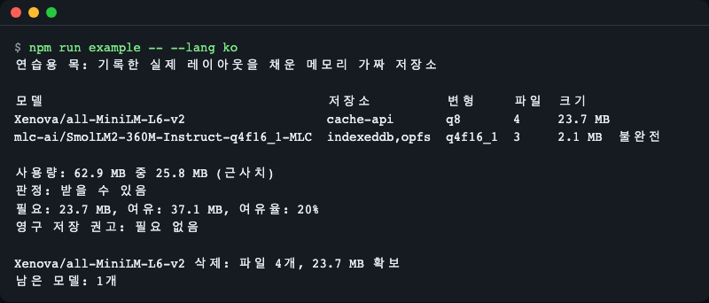
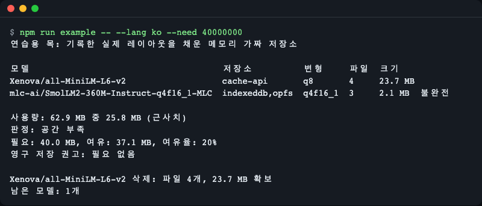
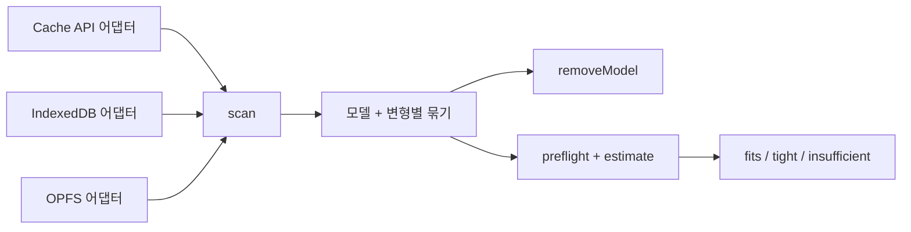

# webai-storage

[English](README.md) | **한국어**

Transformers.js·WebLLM 같은 브라우저 AI 라이브러리는 모델 파일(수십 MB~수 GB)을 사용자 브라우저에 저장합니다. `webai-storage` 는 모델 ID 를 몰라도 이 오리진이 Cache API·IndexedDB·OPFS 에 쌓은 파일을 한 번에 열거하고, 모델·변형(양자화)별로 합산하고, 모델 단위로 삭제하고, 다운로드 전에 자리가 있는지 알려 줍니다. 바로 붙일 수 있는 React 패널(영어·한국어)도 들어 있습니다. 코어는 런타임 의존성이 없습니다.



*`npm run example` 출력(연습용 목, [빠르게 시작하기](#빠르게-시작하기) 참고).*

## 설치

```bash
npm install webai-storage
```

- 브라우저(ES 모듈)에서 동작합니다. 테스트와 예제는 Node 22.12 이상이 필요합니다.
- 런타임 의존성: 없음. `react`(18 또는 19)는 선택 peer 의존성이고 `webai-storage/react` 에만 필요합니다.
- Node 가 없다면 `brew install node`(macOS) 또는 [nodejs.org](https://nodejs.org/). 최소 리눅스 이미지에서는 저장소를 받으려면 `git`, `ca-certificates` 도 필요합니다.

## 빠르게 시작하기

`examples/quickstart.mjs` 는 메모리 가짜 저장소(`webai-storage/testing`)로 Node 에서 돌아갑니다. 실제 페이지에서는 `env` 인자와 가짜 설정을 빼면 라이브러리가 브라우저의 `caches`·`indexedDB`·`navigator.storage` 를 읽습니다.

```js
import { scan, preflight, formatBytes } from "webai-storage";
import { createFakeEnv } from "webai-storage/testing";

const env = createFakeEnv({ quota: 100_000_000, usage: 30_000_000 });
const cache = await env.caches.open("transformers-cache");
const url = "https://huggingface.co/Xenova/all-MiniLM-L6-v2/resolve/main/onnx/model_quantized.onnx";
await cache.put(url, new Response(new Uint8Array(23_000_000), { headers: { "content-length": "23000000" } }));

const { models } = await scan({ env });
for (const m of models) console.log(m.id, m.variants.join(","), formatBytes(m.bytes), m.stores.join(","));

const check = await preflight({ needBytes: 60_000_000 }, { env });
console.log(check.verdict, formatBytes(check.freeBytes), check.persistAdvice);
```

```text
Xenova/all-MiniLM-L6-v2 q8 23.0 MB cache-api
tight 70.0 MB none
```

첫 줄은 캐시에서 찾은 모델과 양자화 변형(`q8`)·크기·저장소입니다. 둘째 줄은 60 MB 다운로드가 `tight` 라는 뜻입니다. 남은 70 MB 는 필요량은 덮지만 기본 여유율 20 % 는 덮지 못합니다.

전체 흐름(저장소 세 곳, 불완전 다운로드, 삭제)은 저장소를 받아 연습용 목 예제로 확인합니다.

```bash
git clone https://github.com/LeeGyeongPil/webai-storage.git
cd webai-storage
npm install
npm run example -- --lang ko
```

```text
연습용 목: 기록한 실제 레이아웃을 채운 메모리 가짜 저장소

모델                                      저장소          변형     파일  크기
Xenova/all-MiniLM-L6-v2                   cache-api       q8       4     23.7 MB
mlc-ai/SmolLM2-360M-Instruct-q4f16_1-MLC  indexeddb,opfs  q4f16_1  3     2.1 MB  불완전

사용량: 62.9 MB 중 25.8 MB (근사치)
판정: 받을 수 있음
필요: 23.7 MB, 여유: 37.1 MB, 여유율: 20%
영구 저장 권고: 필요 없음

Xenova/all-MiniLM-L6-v2 삭제: 파일 4개, 23.7 MB 확보
남은 모델: 1개
```

이것은 **연습용 목(mock)** 입니다. 저장소는 Transformers.js 4.3.2 와 WebLLM 0.2.88 에서 기록한 파일 이름·크기로 채운 메모리 가짜이고 파일 내용은 0 입니다. 그 위에서 실제 `scan`·`preflight`·`removeModel` 코드가 돕니다. 이 저장소의 테스트는 실제 브라우저 저장소로 돌려 보지 않았으니, 쓰기 전에 실제 페이지에서 확인하세요.



*`npm run example -- --lang ko --need 40000000`: 40.0 MB 가 필요한데 여유가 37.1 MB 라서 판정이 "부족"입니다.*

## 핵심 개념



기본 어댑터가 보는 위치(Transformers.js 4.3.2 와 WebLLM 0.2.88 에서 기록한 형식):

| 라이브러리 | 저장소 | 위치 |
|---|---|---|
| Transformers.js | Cache API | 캐시 `transformers-cache` |
| WebLLM | Cache API | 이름이 `webllm/*` 인 캐시 |
| WebLLM | IndexedDB | 이름이 `webllm/*` 인 데이터베이스(모델 URL 이 키) |
| WebLLM | OPFS | 루트 디렉터리 `tvmjs-opfs-store` |

- **어댑터**: 저장소 하나의 파일을 나열하고 지우는 방법을 아는 부품입니다. 세 개가 들어 있고 직접 만들 수도 있습니다(`StorageAdapter`).
- **모델 묶음**: `https://huggingface.co/<org>/<repo>/resolve/<revision>/<file>` 형태의 URL 을 모델 ID 로 묶습니다. 양자화 변형은 파일 이름(`model_quantized.onnx` 는 `q8`)이나 MLC 모델 ID(`...-q4f16_1-MLC`)에서 읽습니다. 맞지 않는 URL 은 `(other)` 묶음으로 갑니다.
- **불완전(partial)**: 저장된 크기가 쓰는 쪽이 알린 크기보다 작은 파일은 `partial` 로 표시합니다(중단된 다운로드).
- **판정(verdict)**: `fits`(남은 공간이 필요량에 여유율, 기본 20 %을 더한 값 이상), `tight`(필요량만 덮음), `insufficient`, `unknown`(브라우저가 추정치를 주지 않음). 수치는 근사치인 `navigator.storage.estimate()` 에서 오므로 결과에 `approximate: true` 가 붙습니다. 다운로드 중에 `QuotaExceededError` 로 쓰기가 실패할 수도 있습니다. 여유율을 두는 이유는 브라우저가 다른 출처 응답에 대해 `estimate()` 수치를 부풀릴 수 있고, 할당량이 곧 남은 디스크 용량은 아니기 때문입니다(MDN [Storage quotas and eviction criteria](https://developer.mozilla.org/en-US/docs/Web/API/Storage_API/Storage_quotas_and_eviction_criteria), 2026-11-17 확인).
- **영구 저장 권고**: 남은 필요량이 100 MB 이상이고 아직 영구 저장이 아니면 `recommend`, 이미 영구면 `already`, 그 외 `none`. 브라우저가 `persist()` 를 거절할 수 있고 그것은 오류가 아니라 정상 답입니다.

## API

메인 진입점 `webai-storage`:

| 이름 | 하는 일 | 주요 인자 | 반환 |
|---|---|---|---|
| `scan(opts?)` | 모든 어댑터의 저장 파일을 나열하고 모델별로 묶음 | `adapters`, `env`, `hosts`, `measureUnknown` | `Promise<ScanResult>` (`entries`, `models`, `estimate`, `persisted`, `skipped`) |
| `removeModel(id, opts?)` | 한 모델의 저장 파일을 모두 삭제, 모르는 ID 는 아무것도 지우지 않음 | `id`, `adapters`, `env`, `hosts`, `store` | `Promise<RemoveResult>` (`filesDeleted`, `bytesFreed`) |
| `clearAll(opts?)` | 모든 모델 또는 `match(group)` 이 참인 모델 삭제 | `match` 와 `removeModel` 옵션 | `Promise<RemoveResult>` |
| `preflight(input, opts?)` | 예정된 다운로드의 판정. `input` 은 `{ needBytes }`, `{ model?, files: [{ name?, size }] }`(이미 저장된 용량은 `model` 을 주고 모든 파일에 `name` 이 있을 때만 뺌), `{ hf: { model, files, revision? } }` | `margin`(0.2), `scan`, `env`, `recommendPersistAboveBytes`(100 MB) | `Promise<Preflight>` |
| `fetchHfFileSizes({ model, files, ... })` | `Range: bytes=0-0` 로 Hugging Face 파일 크기를 읽음(본문은 받지 않음) | `revision`, `host`, `fetch` | `Promise<{ files, total }>` |
| `requestPersist(opts?)` | 아직 영구 저장이 아닐 때만 영구 저장을 요청 | `env` | `Promise<{ supported, persistedBefore, granted }>` |
| `cacheApiAdapter`, `indexedDbAdapter`, `opfsAdapter`, `defaultAdapters()` | 기본 제공 저장소. 기본값: Cache `transformers-cache`·`webllm/*`, IndexedDB `webllm/*` 영역, OPFS 루트 `tvmjs-opfs-store` | `names`, `prefixes` / `databases`, `storeName` / `root` | `StorageAdapter` |
| `groupEntries(entries, hosts?)`, `parseModelUrl(url, hosts?)`, `detectVariant(id, file)` | `scan` 이 쓰는 부품 | | 묶음 / 파싱된 URL / 변형 |
| `formatBytes(n, lang?)` | 십진 단위: `23685047` 은 `23.7 MB` | | `string` |
| `t`, `messages`, `resolveLang`, `detectBrowserLang`, `LANGS`, `LANG_STORAGE_KEY` | 메시지 카탈로그(영어·한국어)와 언어 감지 | | |
| `WebAiStorageError`, `InvalidInputError`, `HfLookupError` | 오류. 잘못된 인자는 `InvalidInputError`, 목록을 못 읽은 저장소는 던지지 않고 `scan().skipped` 에 기록 | | |

`webai-storage/react`: `useModelStorage({ env?, adapters? })` 는 `{ result, loading, error, removeError, lastRemoved, lastPersist, refresh, remove, persist }` 를 돌려주고(`remove(id)` 는 성공하면 `true`, 삭제가 실패하면 `false` 이며 이때 `removeError` 에 오류와 모델 id 가 담깁니다), `<ModelStoragePanel lang? env? adapters? onRemoved? />` 는 설정 패널입니다. `webai-storage/testing`: `createFakeEnv`, `createFakeCacheStorage`, `createFakeStorageManager`, `createFakeOpfsRoot`, `writeOpfsFile`, `putIndexedDbRecord`, `seedRecordedLayout`.

## 사용 예

**"저장된 모델" 목록이 있는 설정 패널**

```tsx
import { ModelStoragePanel } from "webai-storage/react";

export function Settings() {
  return <ModelStoragePanel onRemoved={(id) => console.log("removed", id)} />;
}
```

패널은 큰 모델부터 나열하고, 사용량 막대를 보여 주고, 삭제 전에 "Yes, delete" 확인을 받고(삭제 실패는 알림으로 보여 줌), 영구 저장 버튼을 둡니다. `lang` 속성이 없으면 언어 메뉴(English·한국어)를 보여 주고 선택을 `localStorage` 의 `webai-storage.lang` 에 기억하며, 첫 방문에는 `navigator.language` 를 따릅니다. `lang="en"` 또는 `lang="ko"` 를 주면 메뉴가 숨겨집니다. 이 저장소의 테스트는 가짜 브라우저(happy-dom)로 패널을 확인합니다. 이 빌드 환경에서는 브라우저를 띄울 수 없어 스크린샷은 터미널 장면만 있습니다.

**다운로드 전 확인**

```js
import { preflight, requestPersist, scan } from "webai-storage";

const before = await scan();
const check = await preflight(
  { hf: { model: "Xenova/all-MiniLM-L6-v2", files: ["onnx/model_quantized.onnx"] } },
  { scan: before },
);
if (check.verdict === "insufficient") showMessage("Free some space first");
if (check.persistAdvice === "recommend") await requestPersist();
```

이미 저장된 파일은 필요량에서 빼 줍니다. `fetchHfFileSizes` 는 Hugging Face 로 네트워크 접속이 필요합니다.

**모델 하나 또는 일정 크기 이상 전부 삭제**

```js
import { clearAll, removeModel } from "webai-storage";

await removeModel("Xenova/all-MiniLM-L6-v2");
await clearAll({ match: (g) => g.bytes > 1_000_000_000 });
```

**직접 만든 저장소 추가**

```js
import { defaultAdapters, scan } from "webai-storage";

const myStore = {
  name: "my-store",
  async list(env, opts) { return []; },   // Entry[] 를 돌려줌
  async remove(env, entry) {},
};
const result = await scan({ adapters: [...defaultAdapters(), myStore] });
```

## 언제 쓰나

- 잘 맞는 경우: 브라우저 안에서 모델을 돌리는 기능을 내놓으면서, 모델 ID 를 몰라도 Cache API·IndexedDB·OPFS 를 가로질러 "저장된 모델" 화면이나 "자리가 있나" 확인이 필요할 때.
- 다른 도구가 나은 경우: 한 라이브러리의 알려진 모델 하나만 지우면 된다면 그 라이브러리의 캐시 함수([Transformers.js](https://huggingface.co/docs/transformers.js), [WebLLM](https://webllm.mlc.ai/docs/))로 충분합니다. 범용 OPFS 파일 API 가 필요하면 [opfs-tools](https://www.npmjs.com/package/opfs-tools).

## 언어

예제 CLI 의 언어는 `--lang en|ko`, `WEBAI_STORAGE_LANG`, `LC_ALL`, `LC_MESSAGES`, `LANG` 순으로 정해지고 한국어가 아니면 영어입니다. 영어로 보려면:

```bash
npm run example -- --lang en
```

출력은 `Practice mock: ...`, `Verdict: fits`, `partial` 로 바뀝니다. 영어 스크린샷은 [README.md](README.md) 에 있습니다.

## 문제 해결

| 증상 | 원인 | 해결 |
|---|---|---|
| 모델이 `(other)` 아래에 나옴 | URL 이 알려진 호스트의 `.../resolve/<revision>/<file>` 형태가 아님 | `scan`, `removeModel` 에 `hosts: ["your-mirror.example"]` 를 넘김 |
| `verdict` 가 `unknown` | 브라우저에 `navigator.storage.estimate()` 가 없거나 수치를 주지 않음 | "알 수 없음"으로 다루고 쓰기 때 `QuotaExceededError` 를 처리 |
| 어떤 저장소가 결과에 없음 | `list` 가 예외를 던짐(막혔거나 API 없음) | `scan().skipped` 에서 저장소와 이유 확인 |
| 일부 파일의 크기가 `unknown` | 캐시된 응답에 `content-length` 가 없음 | `measureUnknown: true`(본문을 읽어서 느리고 메모리를 많이 쓸 수 있음) |
| `npm run example` 이 문법 오류로 실패 | 오래된 Node | Node 22.12 이상 사용 |

## 버전·호환성

- [유의적 버전(SemVer)](https://semver.org/lang/ko/)을 따릅니다. 0.x 동안은 마이너 버전에서 API 가 바뀔 수 있고, 바뀌면 [CHANGELOG.md](CHANGELOG.md) 에 적습니다.
- 알려진 한계: IndexedDB 스캔은 `getAll` 로 레코드 값을 읽어 수 GB 저장소에서는 메모리를 많이 쓸 수 있습니다. `.bin` 이 없거나 `.record.json` 을 읽을 수 없는 OPFS 항목은 `(other)` 로 갑니다. 기본 어댑터는 Transformers.js 4.3.2 와 WebLLM 0.2.88 의 저장 형식에 맞춰져 있어 다른 버전은 다른 위치에 저장할 수 있습니다.
- 다른 탭·워커가 쓰는 모델을 지우면 그 모델이 깨지거나 삭제가 실패할 수 있습니다. `removeModel`·`clearAll` 은 이를 확인하지 않으니 다른 사용처를 먼저 닫으세요.
- 내 출처(origin)의 저장소만 다룹니다. 다른 출처(예: 다른 사이트가 캐시한 모델)의 저장소는 읽거나 지울 수 없습니다.
- `npm run example` 은 `--need abc` 같은 잘못된 입력에 짧은 메시지와 종료 코드 2 로 끝납니다.

## 개발·기여

```bash
npm install
npm run typecheck
npm test
```

## 라이선스

MIT.
