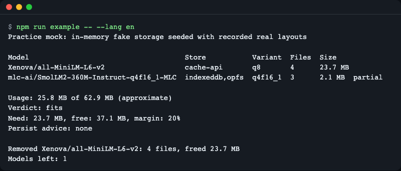
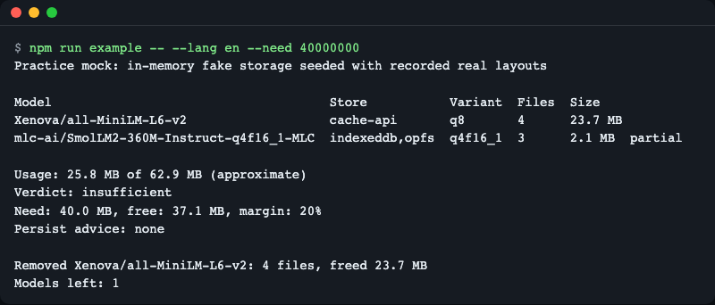
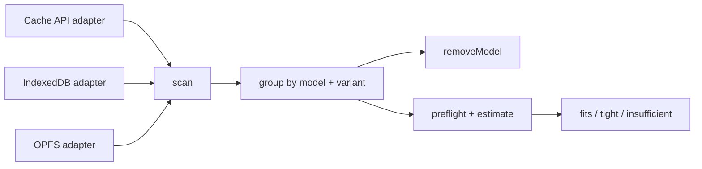

# webai-storage

**English** | [한국어](README.ko.md)

Browser AI libraries such as Transformers.js and WebLLM save model files (tens of MB to several GB) in the user's browser. `webai-storage` lists everything your origin has stored in the Cache API, IndexedDB and OPFS without needing model IDs, adds the files up per model and per variant (quantization), deletes by model, and tells you before a download whether it will fit. A ready-made React panel (English and Korean) is included. The core has zero runtime dependencies.



*Output of `npm run example` (practice mock, see [Quick start](#quick-start)).*

## Install

```bash
npm install webai-storage
```

- Runs in browsers (ES modules). For tests and the example, Node 22.12 or newer.
- Runtime dependencies: none. `react` (18 or 19) is an optional peer dependency, needed only for `webai-storage/react`.
- Node is not installed? `brew install node` (macOS) or see [nodejs.org](https://nodejs.org/). On a minimal Linux image you also need `git` and `ca-certificates` to clone the repository.

## Quick start

`examples/quickstart.mjs` runs in Node against in-memory fakes (`webai-storage/testing`). In a real page you drop the `env` argument and the fake setup: the library then reads the browser's `caches`, `indexedDB` and `navigator.storage`.

```js
import { scan, preflight, formatBytes } from "webai-storage";
import { createFakeEnv } from "webai-storage/testing";

const env = createFakeEnv({ quota: 100_000_000, usage: 30_000_000 });
const cache = await env.caches.open("transformers-cache");
const url = "https://huggingface.co/Xenova/all-MiniLM-L6-v2/resolve/main/onnx/model_quantized.onnx";
await cache.put(url, new Response(new Uint8Array(23_000_000), { headers: { "content-length": "23000000" } }));

const { models } = await scan({ env });
for (const m of models) console.log(m.id, m.variants.join(","), formatBytes(m.bytes), m.stores.join(","));

const check = await preflight({ needBytes: 60_000_000 }, { env });
console.log(check.verdict, formatBytes(check.freeBytes), check.persistAdvice);
```

```text
Xenova/all-MiniLM-L6-v2 q8 23.0 MB cache-api
tight 70.0 MB none
```

The first line is the model found in the cache, with its quantization variant (`q8`), size and store. The second says a 60 MB download is `tight`: 70 MB is free, which covers the need but not the default 20 % margin.

To try the full flow (three stores, a partial download, delete) clone the repository and run the practice-mock example:

```bash
git clone https://github.com/LeeGyeongPil/webai-storage.git
cd webai-storage
npm install
npm run example -- --lang en
```

```text
Practice mock: in-memory fake storage seeded with recorded real layouts

Model                                     Store           Variant  Files  Size
Xenova/all-MiniLM-L6-v2                   cache-api       q8       4      23.7 MB
mlc-ai/SmolLM2-360M-Instruct-q4f16_1-MLC  indexeddb,opfs  q4f16_1  3      2.1 MB  partial

Usage: 25.8 MB of 62.9 MB (approximate)
Verdict: fits
Need: 23.7 MB, free: 37.1 MB, margin: 20%
Persist advice: none

Removed Xenova/all-MiniLM-L6-v2: 4 files, freed 23.7 MB
Models left: 1
```

This is a **practice mock**: the storage is in-memory fakes filled with file names and sizes recorded from Transformers.js 4.3.2 and WebLLM 0.2.88, and the file bodies are zeros. The real `scan`, `preflight` and `removeModel` code runs on top. It has not been run against a real browser's storage in this repository's tests, so verify on a real page before relying on it.



*`npm run example -- --need 40000000`: 40.0 MB needed, 37.1 MB free, so the verdict is `insufficient`.*

## Core concepts



Where the default adapters look (layouts recorded from Transformers.js 4.3.2 and WebLLM 0.2.88):

| Library | Store | Location |
|---|---|---|
| Transformers.js | Cache API | cache `transformers-cache` |
| WebLLM | Cache API | caches named `webllm/*` |
| WebLLM | IndexedDB | databases named `webllm/*` (model URLs as keys) |
| WebLLM | OPFS | root directory `tvmjs-opfs-store` |

- **Adapter**: knows how to list and delete files in one store. Three are built in; you can write your own (`StorageAdapter`).
- **Model group**: URLs of the form `https://huggingface.co/<org>/<repo>/resolve/<revision>/<file>` are grouped by model ID. The quantization variant is read from the file name (`model_quantized.onnx` is `q8`) or from MLC model IDs (`...-q4f16_1-MLC`). URLs that do not match go to a group called `(other)`.
- **Partial**: a stored file smaller than the size its writer announced is flagged `partial` (an interrupted download).
- **Verdict**: `fits` (free space covers the need plus a margin, default 20 %), `tight` (covers the need only), `insufficient`, or `unknown` (the browser gave no estimate). The numbers come from `navigator.storage.estimate()`, which is an approximation, so results carry `approximate: true`. A write can still fail with `QuotaExceededError` mid-download. The margin exists because browsers may pad `estimate()` numbers for cross-origin responses and the quota is not the same as free disk space (see MDN, [Storage quotas and eviction criteria](https://developer.mozilla.org/en-US/docs/Web/API/Storage_API/Storage_quotas_and_eviction_criteria), checked 2026-11-17).
- **Persist advice**: `recommend` when the remaining need is at least 100 MB and the storage is not persistent yet, `already` when it is, otherwise `none`. A browser may refuse `persist()`; that is a normal answer, not an error.

## API

Main entry `webai-storage`:

| Name | What it does | Main arguments | Returns |
|---|---|---|---|
| `scan(opts?)` | Lists stored files in all adapters, groups them per model | `adapters`, `env`, `hosts`, `measureUnknown` | `Promise<ScanResult>` (`entries`, `models`, `estimate`, `persisted`, `skipped`) |
| `removeModel(id, opts?)` | Deletes every stored file of one model; unknown IDs delete nothing | `id`, `adapters`, `env`, `hosts`, `store` | `Promise<RemoveResult>` (`filesDeleted`, `bytesFreed`) |
| `clearAll(opts?)` | Deletes all models, or those for which `match(group)` is true | `match`, plus `removeModel` options | `Promise<RemoveResult>` |
| `preflight(input, opts?)` | Verdict for a planned download. `input` is `{ needBytes }`, `{ model?, files: [{ name?, size }] }` (already-stored bytes are subtracted only when `model` is given and every file has a `name`) or `{ hf: { model, files, revision? } }` | `margin` (0.2), `scan`, `env`, `recommendPersistAboveBytes` (100 MB) | `Promise<Preflight>` |
| `fetchHfFileSizes({ model, files, ... })` | Reads Hugging Face file sizes with `Range: bytes=0-0`, no body downloaded | `revision`, `host`, `fetch` | `Promise<{ files, total }>` |
| `requestPersist(opts?)` | Asks for persistent storage only if it is not already persistent | `env` | `Promise<{ supported, persistedBefore, granted }>` |
| `cacheApiAdapter`, `indexedDbAdapter`, `opfsAdapter`, `defaultAdapters()` | Built-in stores. Defaults: Cache `transformers-cache` and `webllm/*`; IndexedDB `webllm/*` scopes; OPFS root `tvmjs-opfs-store` | `names`, `prefixes` / `databases`, `storeName` / `root` | `StorageAdapter` |
| `groupEntries(entries, hosts?)`, `parseModelUrl(url, hosts?)`, `detectVariant(id, file)` | Building blocks used by `scan` | | groups / parsed URL / variant |
| `formatBytes(n, lang?)` | Decimal units: `23685047` is `23.7 MB` | | `string` |
| `t`, `messages`, `resolveLang`, `detectBrowserLang`, `LANGS`, `LANG_STORAGE_KEY` | Message catalog (English, Korean) and language detection | | |
| `WebAiStorageError`, `InvalidInputError`, `HfLookupError` | Errors. Invalid arguments throw `InvalidInputError`; a store that fails to list is reported in `scan().skipped`, not thrown | | |

`webai-storage/react`: `useModelStorage({ env?, adapters? })` returns `{ result, loading, error, removeError, lastRemoved, lastPersist, refresh, remove, persist }` (`remove(id)` resolves to `true`, or `false` when the delete fails; `removeError` then holds the error and the model id); `<ModelStoragePanel lang? env? adapters? onRemoved? />` is the settings panel. `webai-storage/testing`: `createFakeEnv`, `createFakeCacheStorage`, `createFakeStorageManager`, `createFakeOpfsRoot`, `writeOpfsFile`, `putIndexedDbRecord`, `seedRecordedLayout`.

## Usage examples

**Settings panel with a "stored models" list**

```tsx
import { ModelStoragePanel } from "webai-storage/react";

export function Settings() {
  return <ModelStoragePanel onRemoved={(id) => console.log("removed", id)} />;
}
```

The panel lists models largest first, shows a usage bar, asks "Yes, delete" before deleting (a failed delete is shown as an alert), and has a button for persistent storage. Without a `lang` prop it shows a language menu (English or 한국어) and remembers the choice in `localStorage` under `webai-storage.lang`; on the first visit it follows `navigator.language`. With `lang="en"` or `lang="ko"` the menu is hidden. The repository's tests cover the panel with a fake browser (happy-dom); the screenshot scenes below use the terminal because browsers cannot run in this build environment.

**Check before downloading**

```js
import { preflight, requestPersist, scan } from "webai-storage";

const before = await scan();
const check = await preflight(
  { hf: { model: "Xenova/all-MiniLM-L6-v2", files: ["onnx/model_quantized.onnx"] } },
  { scan: before },
);
if (check.verdict === "insufficient") showMessage("Free some space first");
if (check.persistAdvice === "recommend") await requestPersist();
```

Files already stored are subtracted from the need. `fetchHfFileSizes` needs network access to Hugging Face.

**Delete one model, or everything over a size**

```js
import { clearAll, removeModel } from "webai-storage";

await removeModel("Xenova/all-MiniLM-L6-v2");
await clearAll({ match: (g) => g.bytes > 1_000_000_000 });
```

**Add your own store**

```js
import { defaultAdapters, scan } from "webai-storage";

const myStore = {
  name: "my-store",
  async list(env, opts) { return []; },   // return Entry[]
  async remove(env, entry) {},
};
const result = await scan({ adapters: [...defaultAdapters(), myStore] });
```

## When to use it

- Good fit: you ship an in-browser model feature and want a "stored models" screen or a "will it fit" check that works across Cache API, IndexedDB and OPFS without knowing model IDs.
- Use something else when: you only need to delete one known model of one library, which the library's own cache functions (for example [Transformers.js](https://huggingface.co/docs/transformers.js) or [WebLLM](https://webllm.mlc.ai/docs/)) cover; or you want a general OPFS file API, see [opfs-tools](https://www.npmjs.com/package/opfs-tools).

## Language

The example CLI picks its language in this order: `--lang en|ko`, then `WEBAI_STORAGE_LANG`, then `LC_ALL`, `LC_MESSAGES`, `LANG`; anything that is not Korean means English. The same example in Korean:

```bash
npm run example -- --lang ko
```

The output then reads `연습용 목: ...`, `판정: 받을 수 있음` and `불완전` (partial); [README.ko.md](README.ko.md) shows the Korean screenshot.

## Troubleshooting

| Symptom | Cause | Fix |
|---|---|---|
| A model shows up under `(other)` | Its URL is not a `.../resolve/<revision>/<file>` URL on a known host | Pass `hosts: ["your-mirror.example"]` to `scan` and `removeModel` |
| `verdict` is `unknown` | The browser has no `navigator.storage.estimate()` or it returned no numbers | Treat as "cannot tell"; handle `QuotaExceededError` when writing |
| A store is missing from results | Its `list` threw (blocked or unavailable API) | Read `scan().skipped` for the store and reason |
| `size` is `unknown` for some files | The cached response has no `content-length` | Pass `measureUnknown: true` (reads the body, can be slow and memory heavy) |
| `npm run example` fails with a syntax error | Old Node | Use Node 22.12 or newer |

## Version and compatibility

- Follows [Semantic Versioning](https://semver.org/). While the version is 0.x, minor versions may change the API; changes are listed in [CHANGELOG.md](CHANGELOG.md).
- Known limits: the scan of IndexedDB reads record values with `getAll`, which can use a lot of memory for multi-GB stores. OPFS entries without a `.bin` file or with an unreadable `.record.json` fall into `(other)`. The default adapters match the layouts of Transformers.js 4.3.2 and WebLLM 0.2.88; other versions may store files elsewhere.
- Deleting a model that another tab or worker is using can break that model or fail; `removeModel` and `clearAll` do not check for this, so close other users first.
- Only your own origin's storage is covered. Storage of other origins (for example a model cached by a different site) cannot be read or deleted.
- `npm run example` exits with code 2 and a short message on invalid input such as `--need abc`.

## Development

```bash
npm install
npm run typecheck
npm test
```

## License

MIT.
